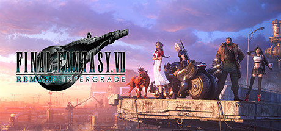

**Final Fantasy VII Remake is a stunning reimagining of the classic RPG's Midgar chapter, expanding Cloud and AVALANCHE's story into a full 40-hour action RPG with real-time combat and deep ATB strategy. Features incredible production values and emotional character development.**

---

## 📖 About

Final Fantasy VII Remake is a stunning reimagining of the classic RPG's Midgar chapter, expanding Cloud and AVALANCHE's story into a full 40-hour action RPG with real-time combat and deep ATB strategy. Features incredible production values and emotional character development.

## ⚠️ Problems Without Trainer

| Problem | Status |
|---------|--------|
| **Hard Mode Locking** — Hard difficulty removes item use, making healing extremely limited | ✅ Solved |
| **Chapter Replay Required** — Missing manuscripts needs full chapter replays | ✅ Solved |
| **Stagger Dependency** — Dealing significant damage requires understanding stagger mechanics | ✅ Solved |
| **Enemy Intel Grind** — Completing Chadley's reports requires specific battle conditions | ✅ Solved |

## ✅ Solution

The **FINAL FANTASY VII REMAKE Trainer** solves all these issues by giving you complete control over the game.

## 🎯 Full Feature List

- Unlimited Resources
- God Mode / Invincibility
- Instant Skill Cooldown
- One-Hit Kill
- Freeze Game Timer
- Unlock All Items & Achievements
- Custom Speed Multiplier
- Save State Anywhere

## 🚀 Quick Start

1. **Disable Windows Defender** temporarily (trainer may trigger false positive)
2. Download the trainer from the button above
3. Launch FINAL FANTASY VII REMAKE
4. Run the trainer as Administrator
5. Activate desired cheats with hotkeys

## 💎 Free vs Paid

| Feature | Free | Pro |
|---------|------|-----|
| Basic God Mode | ✅ | ✅ |
| Unlimited Resources | ✅ | ✅ |
| All Advanced Cheats | ❌ | ✅ |
| Auto-Updates | ❌ | ✅ |
| Priority Support | ❌ | ✅ |

## 💻 Requirements

- Windows 10/11 (64-bit)
- FINAL FANTASY VII REMAKE (any version)
- .NET Framework 4.8+
- DirectX 11+

## 🍎 macOS

macOS users can use our alternative tool:

## ⚖️ Legal

This trainer is for educational and single-player use only. Use responsibly.

---

